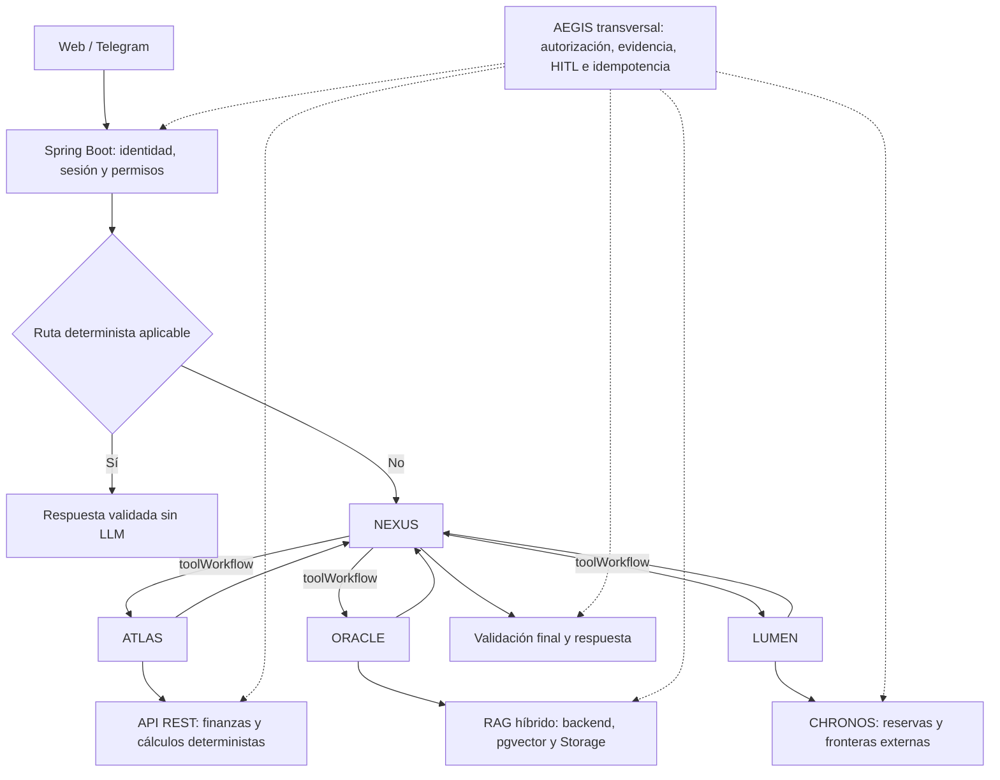
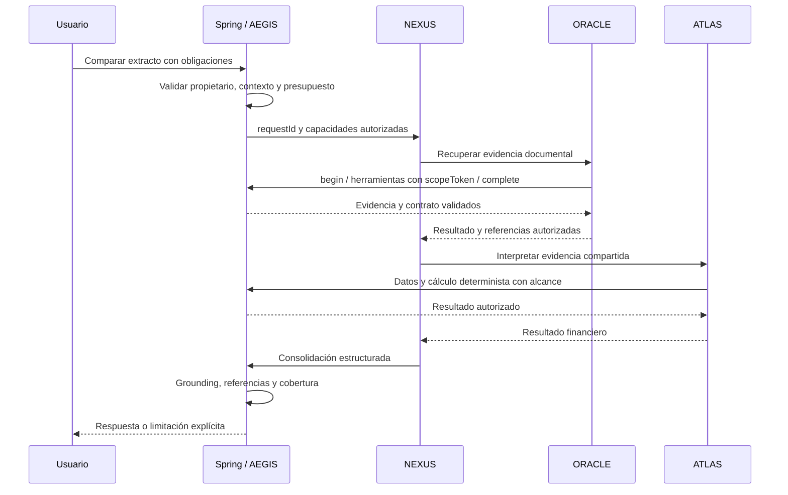

# CEROA AI — Multi-Agent Financial Intelligence Ecosystem

> Nota de vigencia RC2 (14/11/2026): este informe conserva observaciones históricas. El candidato actual, las correcciones R1/R2 y el estado del PR se documentan en [validación final RC2](CEROA_RC2_CORRECCIONES_Y_VALIDACION_FINAL.md). El Grant es autorizado y ligado al servidor, sin firma HMAC/JWS; la ruta actual es `POST /api/v1/workspace-actions/{code}/draft`.

Auditoría: 14 de noviembre de 2026, America/Bogota. Base: `8c6ac23939211228e58112e92b010bd675f7ba86`. Rama local: `docs/ceroa-ai-architecture`.

## Alcance y estado comprobado

Ceroa conserva su monolito modular Spring Boot y sus cuatro agentes cognitivos nativos de n8n. Esta entrega formaliza identidades y fronteras existentes; no crea otro agente LLM, no reconstruye RAG y no modifica datos ni servicios operativos.

Git local y HEAD remoto consultado siguen en 8c6ac23. La recuperación posterior de esta sesión encontró Docker Desktop operativo (Engine 29.9.2, Compose 5.6.1). Los cinco contenedores operativos de Ceroa están detenidos desde el 9/10 de noviembre; no se arrancaron ni reiniciaron. Ubuntu/WSL dispone además de un daemon separado, Engine 29.1.3, sin contenedores Ceroa. Los puertos del producto permanecen sin servicio porque sus contenedores están detenidos.

El preflight nuevo, estrictamente de lectura, confirma Supabase PostgreSQL 17.6, historial Flyway exitoso hasta V30, V31 ausente y siete eventos SHEETS/PENDING. El inventario SQLite publicado leído con volumen solo lectura confirma 30 workflows, 15 activos/publicados, 15 inactivos y 22 credenciales. Los cuatro conversacionales no tienen divergencia entre borrador y publicación. Activo/publicado en SQLite no equivale a servidor operativo cuando el contenedor está detenido. [Inventario nuevo](benchmarks/ceroa-recovery-2026-11-14/runtime-readonly.json).

Se recuperó el candidato B12 en `tmp/block10-build-results/ceroa-backend-0.1.0-SNAPSHOT.jar`: SHA-256 `dbc8b235ecc7cb94934c88037729cc903e7dbd66eaf0608f33f7290e3f248b8b`, idéntico al original validado. Sus 31 migraciones coinciden con el código tras normalizar CR. No se recompiló ni sobrescribió el JAR de backend/target, cuyo hash distinto sigue identificado en el informe inicial. Las compilaciones/pruebas nuevas utilizaron exclusivamente copias bajo tmp/ceroa-recovery.

Los tres respaldos B12 existen en Ubuntu, sus hashes coinciden con el manifiesto y se autenticaron nuevamente en memoria con AES-GCM, red deshabilitada, raíz de contenedor de solo lectura y swap del cgroup a cero. Se rechazaron corrupción y clave incorrecta, sin escribir contenido descifrado. No se repitió la restauración ni se afirma que el snapshot del 9 de noviembre cubra escrituras posteriores. [Candidato](benchmarks/ceroa-recovery-2026-11-14/candidate-verification.json), [respaldos](benchmarks/ceroa-recovery-2026-11-14/backup-verification.json).

## Identidades, responsabilidades y correspondencia académica

| Identidad | Equivalente Stark | Implementación y frontera |
|---|---|---|
| NEXUS — Supervisor & Intelligent Router | Pepper Potts | AI Agent del workflow ceroaHybridQuery20; solo tres herramientas de delegación. Clasifica, coordina y consolida evidencia validada. |
| ATLAS — Financial Intelligence Agent | FRIDAY | ceroaFinancialAgent30, rol FINANCIAL. Finanzas estructuradas, cálculo determinista, FACT_ANALYSIS, capacidad y simulación autorizada. |
| ORACLE — Knowledge & RAG Agent | JARVIS | ceroaKnowledgeAgent30, rol RAG. Conocimiento aprobado, hechos documentales, búsqueda híbrida y PERIOD_ANALYSIS. Conserva pgvector, versiones y Storage. |
| LUMEN — Customer Experience & Support Agent | Especialista propio | ceroaSupportAgent30, rol SUPPORT. Guía operativa, planes, propuestas de soporte y acceso acotado a CHRONOS. |
| CHRONOS — Scheduling & External Integration | VERONICA | Servicios de reservas, gateway Calendar y workflows externos deterministas. No es un quinto agente cognitivo. |
| AEGIS — Governance, Security & Human-in-the-Loop | ULTRON | Capa transversal determinista de Spring Security, AssistantService, AgentRuntime, grounding, reservas y WorkspaceActionService. No es un workflow ni LLM adicional. |

El PDF se localizó en Descargas y se revisaron visualmente sus 12 páginas (es un documento de imágenes sin capa de texto). SHA-256: `452ace1f827bd3d848440545c8aef9e287259f9fab64189acf52b6c2e324b8b4`. La comparación directa y las diferencias literales se detallan en el [informe de recuperación](CEROA_RECUPERACION_Y_VALIDACION_INTEGRADA.md). Las páginas 8–11 sí especifican Google Calendar mediante MCP: la ruta REST/Calendar nativa de Ceroa no satisface literalmente ese transporte. La existencia de otro cliente MCP de capacidades no subsana esa diferencia. No se añadió otro LLM ni se modificó el mecanismo Calendar.

## Topología y patrones

Se mantienen supervisor con delegación vertical, herramientas especializadas, contratos estructurados, evidencia autorizada, presupuestos acotados, caché por solicitud y confirmación humana antes de efectos externos. AEGIS opera antes, durante y después de delegar.

Las deudas, próximos vencimientos y estrategia activa tienen rutas deterministas en AssistantService según intención/contexto. Las confirmaciones de acciones también se procesan fuera del LLM. El contexto se mantiene por propietario, canal y conversación en Spring, con expiración; no se agregó Simple Memory.

## Herramientas, ciclo y contratos

NEXUS recibe modelo Gemini por `ai_languageModel`, parser por `ai_outputParser` y `Delegar a ATLAS`, `Delegar a ORACLE`, `Delegar a LUMEN` por `ai_tool`. Estas herramientas apuntan a IDs constantes; no acceden directamente a herramientas financieras o documentales. `main` enlaza preparación, orquestación, validación y salida.

Cada especialista contiene Execute Workflow Trigger, rechazo de múltiples items, autorización `begin`, posible resultado reutilizable, AI Agent propio, modelo, parser, herramientas autorizadas, comprobación del resultado, `complete`, retorno validado y ruta `fail`. Los especialistas no vuelven a delegar a especialistas. LUMEN incluye una herramienta workflow MCP acotada, cuyo destino es determinista, no otro agente cognitivo.

ATLAS tiene consulta financiera, cálculo con evidencia, consulta documental restringida a FACT_ANALYSIS, simulación hipotética y sobrecapacidad sin alertas. También prepara propuestas de comunicación autorizadas. ORACLE tiene recuperación documental y conocimiento aprobado. LUMEN tiene documentación, propuestas de correo de su alcance, disponibilidad, propuesta/consulta/cancelación de reservas y consulta pública MCP explícita. El acceso documental de ATLAS es una herramienta tipada; no sustituye a ORACLE como especialista de recuperación.

Contratos 1.1: rol FINANCIAL/RAG/SUPPORT, schemaVersion, status OK/PARTIAL/INSUFFICIENT/FAILED, answer, evidenceRefs, sources, coverage, missingData, requiresConfirmation y requiresClarification. El backend añade correlación y métricas. Se preserva compatibilidad 1.0. Los fID son hechos privados autorizados; dID son fuentes públicas recuperadas. NEXUS solo consolida referencias retornadas y validadas; cobertura parcial no puede elevarse a completa.

AgentRuntime liga alcance a solicitud y rol, comprueba capacidades, referencias compartidas y versiones. Profundidad uno, cuatro delegaciones nuevas, límites de iteraciones y herramientas, contexto y plazo. AssistantProviderGate aplica presupuesto agregado, concurrencia y cooldown de cuota; el límite configurado no garantiza disponibilidad del proveedor. No se inventan métricas de llamadas o iteraciones cuando no hay traza.

## Seguridad, HITL y CHRONOS

WorkspaceCalendarGateway acepta una URL privada configurada por operador y una clave de longitud válida; no acepta destinos elegidos por el modelo. Calendar sigue **REST backend → webhook n8n → nodos Google Calendar**, con creación/consulta/borrado y solicitud de Meet. MCP usa otros workflows: cliente controlado de capacidades públicas, soporte con autorización de alcance y servidor/backend con operaciones permitidas. No se afirma que Calendar use MCP.

SupportBookingService separa propuesta, confirmación vigente, comprobación de disponibilidad, creación e inspección de prueba del proveedor. La propiedad se comprueba al resolver la reserva. Conserva estados AMBIGUOUS, PENDING_MEET y CANCEL_AMBIGUOUS; una operación ambigua no se repite automáticamente. Confirmar cancelación exige nonce específico. WorkspaceActionService confirma propuestas de correo y registra eventos con deduplicación; outbox y recibos durables permanecen intactos. Un prompt no sustituye ninguna de estas decisiones.

Las pruebas Java existentes cubren propietario distinto, propuesta sin creación, expiración, confirmación idempotente, prueba del proveedor y estados ambiguos. Se ejecutaron nuevamente con Temurin 25.0.1 y Maven 3.9.11 en Docker aislado. La batería completa registró 437 pruebas: 403 ejecutadas, 34 opt-in omitidas, cero fallos/errores. El host Windows conserva Java 21; no se cambió java.version. Las integraciones deshabilitadas deben responder de forma segura; no se habilitaron para obtener aprobaciones.

## Inventario y nomenclatura local

| Archivo | ID preservado | Nombre visible preparado |
|---|---|---|
| multiagent-query.json | ceroaHybridQuery20 | CEROA AI &#124; NEXUS — Supervisor & Router |
| financial-agent.json | ceroaFinancialAgent30 | CEROA AI &#124; ATLAS — Financial Intelligence |
| knowledge-agent.json | ceroaKnowledgeAgent30 | CEROA AI &#124; ORACLE — Knowledge & RAG |
| support-agent.json | ceroaSupportAgent30 | CEROA AI &#124; LUMEN — Customer Experience & Support |
| workspace-calendar.json | ceroaWorkspaceCalendar40 | CEROA AI &#124; CHRONOS — Scheduling & External Integration |
| workspace-mcp-client.json | ceroaMcpClient40 | CEROA AI &#124; CHRONOS — MCP Client |
| workspace-mcp-support.json | ceroaMcpSupport40 | CEROA AI &#124; CHRONOS — Scoped MCP Support |

AEGIS se identifica mediante notas de canvas y esta documentación; no se crea un workflow ficticio. Las notas separan entrada, agente, gobernanza, resultado/errores y CHRONOS en LUMEN. Se conserva la distribución funcional existente. El cambio de identidad se aplica al final del generador, después de las extensiones heredadas: reescribe nombres, conexiones y referencias `$()` conjuntamente. Se adaptaron el fixture y la selección de herramientas del proveedor simulado. Los perfiles de runtime y las plantillas históricas de recuperación permanecen con sus nombres originales: no se deben mezclar con estas plantillas como procedimiento de actualización operativo.

## Evidencia y veredicto actualizado

La entrega inicial pasó 49 pruebas Node. Tras incorporar la actualización selectiva, **51/51 Node** pasan. La batería Java completa pasó 403 pruebas con 34 omitidas; aparte se ejecutaron dos pruebas Spring/H2 ↔ n8n nativo con proveedor simulado. No se suman esos conteos como casos únicos. Una regresión adicional MAS-01 comprueba la pregunta exacta de deudas, ausencia de webhook y aislamiento entre propietarios; su resultado está en la matriz actualizada.

Se ejecutaron seis escenarios de agentes nativos con proveedor/backend simulados (COMPOSITE, FINANCIAL, RAG, SUPPORT, UNKNOWN, EXTRACTS), y cuatro negativos nativos (BADPARSE, BADREF, BADREQUEST, MULTIITEM). Las trazas redactadas contienen request IDs sintéticos, IDs de ejecución de especialistas disponibles, herramientas efectivamente seleccionadas y latencias. La CLI no persistió ID de ejecución raíz: se mantiene null. Los registros SQLite capturados conservan algunos estados running sin stoppedAt bajo la política de guardado del fixture; no se presentan como recibos durables finales. El éxito funcional procede de las aserciones de salida, resultados devueltos y pruebas HTTP, no de esos estados. [Evidencias nuevas](benchmarks/ceroa-recovery-2026-11-14/).

**Corrección histórica:** API_KEY_INVALID corresponde al intento B3, no al último estado de Gemini. B6 documenta ocho solicitudes correctas con Gemini real, seis completas y dos abstenciones esperadas, sin delegaciones innecesarias ni errores de cuota en esa muestra. El compuesto invocó RAG y Financiero. [Resultados Gemini B6](benchmarks/block6/summary.json), [observaciones nativas B6](benchmarks/block6/native-observations.json). B7 mantiene las 54 aprobaciones E2E históricas reconciliadas; B8 vuelve a probar dos casos Spring+n8n con proveedor simulado. Ninguno de esos resultados equivale a Gemini real ejecutado hoy.

No se ejecutó Gemini real en esta recuperación. Se preparó una [batería acotada sin ejecución](../integrations/verification/ceroa-gemini-plan.json), con datos sintéticos, una muestra por caso, control de cuota y autorización explícita pendiente. No hubo prueba nueva desde navegador ni operaciones Google/pagos reales.

Veredicto: especialización y delegación nativas comprobadas nuevamente; backend y controles críticos con pruebas nuevas. La matriz MAS distingue cobertura de componentes, integración combinada y consultas exactas pendientes. No se declara la aprobación de 18 conversaciones completas. La arquitectura coincide con los principios del profesor, pero conserva diferencias literales: Calendar REST frente a MCP Calendar y propuesta persistente frente a Gmail createDraft.

## Publicación selectiva preparada

`prepare-identity-update.mjs` transforma una exportación autoritativa existente; no usa plantillas portables para sustituir el runtime, no llama APIs y no importa/publica. Conserva credenciales, IDs, endpoints, configuración específica, estados, versiones de origen y ausencia deliberada de mcp-public. Reescribe también claves de conexiones con nombres compuestos como Fallo · Analizar finanzas. Valida referencias y rechaza grafos inválidos. No importa credenciales ni introduce el cliente MCP externo ausente.

El dry-run se realizó sobre el export publicado actual de 30 workflows: siete seleccionados (cuatro cognitivos y tres fronteras CHRONOS), 23 idénticos. La propuesta se importó en n8n 2.40.7 desechable, sin red, sin arrancar servidor y sin publicar: nombres, nodos y conexiones almacenados coincidieron exactamente. [Dry-run](benchmarks/ceroa-recovery-2026-11-14/identity-dry-run.json), [importación nativa aislada](benchmarks/ceroa-recovery-2026-11-14/identity-native-import.json). Las versiones de producción siguen intactas. El ensayo de importación no certifica recuperación de versiones publicadas en el servidor real: la publicación sigue requiriendo backup/export y autorización separados.

## Bloque 13 y estado de entrega

**Bloque 13 pendiente confirmado por lectura actual: Flyway V30 y V31 ausente.** El candidato original fue recuperado y las pruebas usan artefactos separados. Antes del despliegue se requiere respaldo actualizado, control de escritores/consumidores y autorización expresa. Antes de una publicación de identidad se requiere nueva lectura de versiones, comparación de borrador/publicación y propuesta aprobada. No se mezclan las dos ventanas.

IMPLEMENTADO: identidades y actualización selectiva locales. PROBADO: Node, Java y las integraciones/fixtures descritos; no 18 E2E completos ni Gemini nuevo. VERSIONADO: base 8c6ac23; cambios nuevos sin commit/push. DESPLEGADO/ACTIVADO: ninguna modificación de esta entrega. OPERATIVO: producto detenido; entorno de pruebas aislado disponible y verificado.

El [informe de recuperación y preparación](CEROA_RECUPERACION_Y_VALIDACION_INTEGRADA.md) contiene procedencia, contraste académico, archivos, limitaciones y siguiente paso. La [matriz MAS actualizada](CEROA_MULTIAGENT_VALIDATION.md) conserva los 63 E2E históricos sin inflarlos.

## Aclaración de contratos para RC2

El Grant es un contrato autorizado ligado al estado del servidor (scopeToken aleatorio, requestId, rol, referencias y vigencia), con callbacks autenticados y validación de alcance en backend. No lleva firma HMAC/JWS. El endpoint versionado de preparación de borradores es `POST /api/v1/workspace-actions/{code}/draft`; las referencias históricas a workspace-proposals/.../gmail-draft no describen el controlador actual. Se conservan los resultados históricos tal como fueron registrados; el manejo HTTP del nuevo controlador se corrige y valida por separado en RC2. Véase [correcciones y validación RC2](CEROA_RC2_CORRECCIONES_Y_VALIDACION_FINAL.md).
