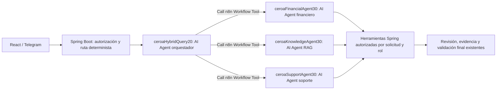

# Bloque 3 — Arquitectura multiagente de Ceroa

Rama: `refactor/n8n-multiagent`. Se conserva el webhook conversacional y el contrato consumido por React y Telegram. No se añadieron pantallas ni integraciones externas.

## Arquitectura implementada



Son cuatro componentes de IA reales. Cada especialista tiene su propio AI Agent, conexión al modelo y Structured Output Parser. Comparten la asociación de credencial Gemini existente. Los resultados vuelven al orquestador mediante la herramienta nativa de workflow. El nombre histórico del nodo raíz, `Analizar finanzas`, se conserva para mantener sus referencias; su función y herramientas ahora son exclusivamente de orquestación y están señaladas en el lienzo.

| Componente | Herramientas |
|---|---|
| Orquestador | Delegación a las tres especialidades; sin herramientas directas de datos |
| Financiero | Datos financieros, cálculo con evidencia, FACT_ANALYSIS, evaluación de sobrecapacidad y simulación hipotética |
| RAG | Conocimiento aprobado, hechos documentales, metadatos, búsqueda híbrida y PERIOD_ANALYSIS |
| Soporte | Conocimiento aprobado y propuesta estructurada de asesoría pendiente de confirmación |

La sobrecapacidad reutiliza la evaluación de Centinela sin crear alertas. Las simulaciones reutilizan `SimulationService`: propietario y suscripción Plus se comprueban nuevamente; se resuelve una obligación por nombre exacto del usuario actual y el abono hipotético debe proceder de un hecho numérico de la pregunta. No se guardan pagos, estrategias ni escenarios. Una propuesta de asesoría solo puede estar en estado `PROPOSED`; no confirma citas ni produce enlaces.

Se mantienen las consultas deterministas de deudas y se agregan coincidencias exactas para próximos vencimientos y estrategia activa. Las solicitudes interpretativas usan delegación; las compuestas pueden coordinar varios especialistas. Una intención desconocida puede devolver únicamente la abstención canónica sin recuperar información; las demás afirmaciones documentales siguen exigiendo evidencia.

## Contratos, límites y seguridad

`AgentRuntime` emite permisos efímeros ligados a la solicitud autenticada. El rol y el identificador se fijan en los nodos del workflow, y el token se enlaza en expresiones HTTP; no se incorpora al prompt. Después de iniciar la orquestación se rechazan las consultas financieras o documentales sin alcance. Los endpoints anteriores siguen funcionando para la ruta híbrida de recuperación.

Los contratos 1.1 incluyen correlación, canal, capacidades, presupuesto, evidencia mínima compartida, cobertura, datos faltantes, aclaración, confirmación, errores recuperables y métricas. Se conserva la validación de esquemas 1.0 para compatibilidad. Los identificadores y las métricas finales los completa el backend. Un especialista solo puede devolver referencias emitidas para su alcance; el orquestador solo puede consolidar referencias de resultados ya validados. La cobertura parcial se transmite entre delegaciones y se conserva en la respuesta final.

Límites: profundidad uno, cuatro delegaciones nuevas, hasta seis iteraciones del orquestador respetando el presupuesto recibido, cuatro por especialista —tres en soporte— y reserva máxima de veintidós iteraciones de agentes. La corrección final existente es una cadena independiente, sin herramientas ni bucle. Se mantienen los límites globales de herramientas, biblioteca, contexto y plazo. Cada alcance admite como máximo ocho invocaciones de herramientas. Los resultados idénticos completados se reutilizan dentro de la solicitud; se rechazan duplicados todavía en ejecución. Se revalidan autorizaciones y versiones antes de reutilizar evidencia documental.

`CEROA_QUERY_METRICS` distingue roles, delegaciones autorizadas, caché, duración, herramientas y contexto. Una autorización de delegación no demuestra por sí sola una llamada al proveedor. Las llamadas exactas al modelo, iteraciones observadas, reintentos internos y duración exclusiva del modelo permanecen no disponibles cuando no hay traza verificable. Se evita contar dos veces el tiempo del backend al envolver una herramienta con su alcance. No se registran prompts, fragmentos, importes ni usuarios en estas métricas.

## Publicación y recuperación

Se evolucionó la exportación publicada de `ceroaHybridQuery20`, conservando sus credenciales y validadores, y se añadieron tres subworkflows con Execute Workflow Trigger. Se publicaron los especialistas antes del orquestador y se reinició únicamente n8n para reconciliar las versiones. El arranque conserva la publicación existente.

Resultado conciliado: **15 workflows publicados, 175 nodos y 38 nodos Code**. Antes eran 12 workflows, 140 nodos y los mismos 38 Code. Los once workflows publicados ajenos al cambio y los trece borradores ajenos al cambio permanecen idénticos. El webhook conversacional conserva su definición; los especialistas no tienen webhooks conversacionales. Los tres nuevos workflows contienen catorce, once y diez nodos, respectivamente, sin Code.

Respaldos autenticados y cifrados:

- `backups/n8n/refactor-block3-2026-11-07-drafts.ceroa`
- `backups/n8n/refactor-block3-2026-11-07-published.ceroa`
- `backups/n8n/refactor-block3-2026-11-07-after.ceroa`

La clave está en el archivo local ignorado `backups/n8n/refactor-block3-2026-11-07.key`. No se versiona. El backend anterior queda en `ceroa-backend:pre-multiagent-20261107`.

Para recuperar la ruta híbrida anterior:

```powershell
powershell -NoProfile -File integrations/n8n/rollback-query-refactor.ps1 `
  -PublishedBackup backups/n8n/refactor-block3-2026-11-07-published.ceroa `
  -KeyFile backups/n8n/refactor-block3-2026-11-07.key
```

Este procedimiento restaura solo el orquestador anterior; los especialistas quedan sin llamadas desde esa ruta. El backend nuevo es compatible con ella. No es necesario restaurar la base de datos. Si también se restaura la imagen, debe usarse la misma combinación de archivos Compose y variables del despliegue actual. Las plantillas portables nuevas son `multiagent-query.json`, `financial-agent.json`, `knowledge-agent.json` y `support-agent.json`; `hybrid-rag-query.json` queda como referencia de recuperación y comparación. Para una instancia existente se debe evolucionar su exportación publicada, como hace `deploy-multiagent.ps1`, en lugar de importar todas las plantillas.

## Verificación y rendimiento

- Batería principal: **131 pruebas Java**, sin fallos, incluidas PostgreSQL/pgvector real en un contenedor desechable, privacidad, hechos financieros, biblioteca, Telegram, recordatorios, Centinela y simulaciones. Tras los últimos ajustes se ejecutaron **37 comprobaciones Java** adicionales de regresión y abstención, también sin fallos; estos conteos incluyen pruebas repetidas, no se suman como casos únicos.
- **27 pruebas Node** y **14 validaciones de esquemas** con el Ajv instalado en n8n.
- Ejecución aislada de agentes nativos en la imagen instalada n8n **2.40.7**: finanzas, RAG, soporte, solicitud compuesta, intención desconocida y comparación de extractos. El caso compuesto ejecuta dos especialistas y el desconocido ninguno. Los proveedores y las herramientas HTTP de esta batería son simulados.
- Prueba integrada: Spring Boot y n8n reales, llamadas HTTP entre servicios, datos financieros sintéticos en H2 y proveedor simulado. Comprueba delegación financiera, devolución de evidencia fresca y abstención con RAG habilitado. No es una prueba productiva con Gemini o Supabase.
- Conciliación de publicaciones, asociación de credenciales y rechazo del webhook sin credencial. Una solicitud sintética inexistente se detiene en preparación, antes del modelo y sin operaciones financieras.

Mediciones puntuales de ejecución nativa, una muestra por caso y arquitectura, con proveedor y backend simulados:

| Consulta | Agente único anterior | Multiagente | Peticiones al proveedor simulado, antes → después |
|---|---:|---:|---:|
| Financiera | 727 ms | 1010 ms | 2 → 4 |
| RAG | 625 ms | 989 ms | 2 → 4 |
| Compuesta | 779 ms | 1081 ms | 3 → 7 |
| Comparación documental | 701 ms | 1015 ms | 2 → 4 |

La ruta determinista de deudas mantiene cero llamadas al modelo; no se volvió a medir su latencia histórica. Los nuevos accesos deterministas se verifican por ausencia de llamada al webhook. Las cifras de la tabla excluyen arranque y cierre de CLI y no representan latencia de producción. La delegación añade trabajo en estas muestras; **no se declara una reducción de latencia conversacional ni percentiles**. Los detalles y límites están en `docs/benchmarks/multiagent-2026-11-07.json`.

La prueba con el Gemini publicado fue intentada y falló con **API_KEY_INVALID** antes de delegar. Por indicación del usuario se continuó con verificación simulada. Quedan pendientes una credencial vigente y pruebas reales de conversación y rendimiento con Gemini, incluyendo consultas documentales amplias y coordinación compuesta. Las validaciones de backend y la delegación nativa sí fueron ejecutadas; la calidad del enrutamiento y de las respuestas del modelo real no se da por comprobada. No se probaron envíos reales a Telegram ni operaciones financieras productivas.
